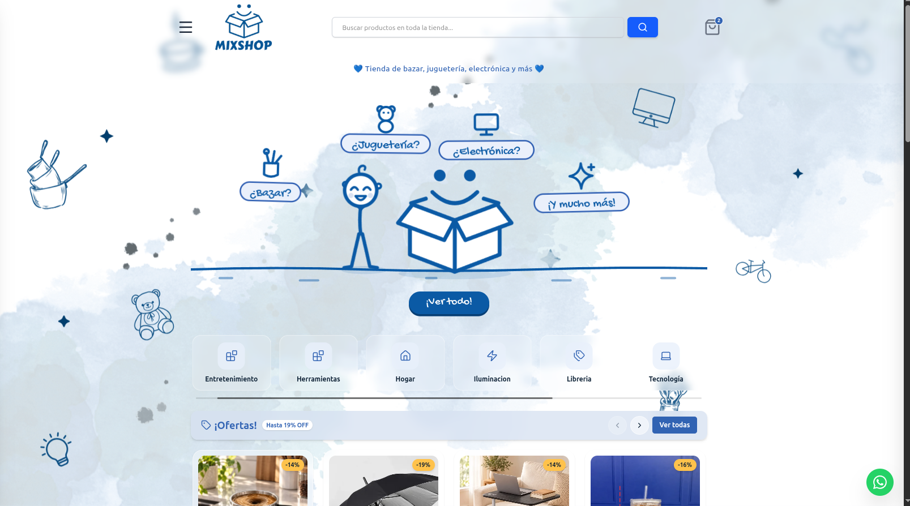
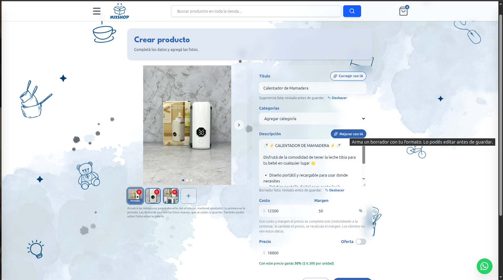
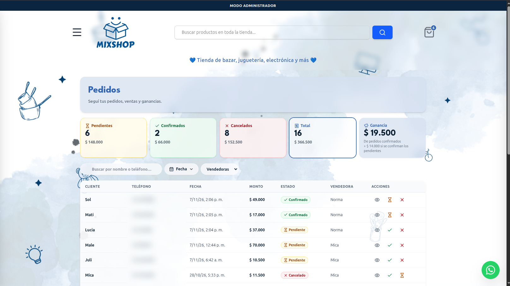

<h1 align="center">Hola, soy Micaela 👋</h1>

  <strong>Analista en Ciencias de la Computación (UNC) · Desarrolladora Full Stack</strong> 
  React · Python · FastAPI · JavaScript · SQL 
  📍 Córdoba, Argentina

  <a href="https://www.linkedin.com/in/micaela-abigail-grande-5830993b3">LinkedIn</a> ·
  <a href="mailto:micaagrande@gmail.com">Email</a>

---

## 👩‍💻 Sobre mí

Soy **Analista en Ciencias de la Computación** (FAMAF – Universidad Nacional de Córdoba) y estudio la **Licenciatura en Ciencias de la Computación** (egreso estimado 2028). Tengo una base sólida en algoritmos, sistemas operativos y bases de datos, y experiencia trabajando en equipos ágiles con Scrum.

Actualmente estoy **becada por la Fundación Fulgor & Tapuy en Robótica e Inteligencia Artificial**, y me gusta construir productos que la gente use de verdad, de la idea al deploy. Busco mi primera posición como desarrolladora **Trainee/Junior**.

---

## 🛍️ Proyecto destacado: Mixshop

**La tienda online de mi propio emprendimiento, en producción: la uso para vender todos los días.**
Mixshop nació de una necesidad real: tener el catálogo y los datos de ventas organizados, y que los clientes puedan comprar sin salir de su casa. Diseñé, programé y publiqué la tienda de punta a punta.

  

  
  

  
  

<strong>📱 En el celular</strong>

  
  
  

- 🤖 **IA generativa (Google Gemini):** redacta las descripciones de los productos (mirando hasta las fotos) y corrige los títulos con el estilo de la marca, con validación de la respuesta y cambio automático de modelo ante fallas.
- 📊 **Panel de administración:** métricas de pedidos por estado, ganancia calculada con el costo congelado al momento de la venta y búsqueda por cliente, teléfono y fecha.
- 💰 **Precios por costo y margen:** el precio se calcula solo (y al revés) y muestra en vivo cuánto se gana por unidad; el costo nunca llega al navegador de los clientes.
- 🔐 **Seguridad:** JWT en cookies httpOnly y contraseñas con Argon2.
- 🖼️ **Experiencia cuidada:** fotos con drag & drop y reordenamiento (también con el dedo), galería deslizable, diseño mobile first y accesible.
- 💬 **Checkout a WhatsApp** con el pedido armado y asignado a la vendedora.

**Stack:** React 19 · Tailwind CSS 4 · FastAPI · SQLAlchemy · Pydantic · PostgreSQL · Cloudinary · Gemini · Cloudflare Pages

🔗 **Tienda en vivo:** [mixshop-frontend.pages.dev](https://mixshop-frontend.pages.dev) · 🔒 El código es privado: pedime acceso si querés verlo.

---

## 📚 Otros proyectos

| Proyecto | Qué hice | Tecnologías |
|---|---|---|
| **Agatha Christie: Death on the Cards** | Juego multijugador en tiempo real, en equipo con Scrum y Jira | FastAPI, React, WebSockets |
| **Sistemas Operativos** | Intérprete de comandos MyBash y optimización del scheduler MLFQ en el kernel xv6 | C |
| **Big Data** | Arquitectura distribuida Master-Worker | Apache Spark |
| **Bases de Datos** | Modelado ER y consultas complejas (ShowHub); CRUD y pipelines de agregación (mflix) | MySQL, MongoDB |
| **Lector de Feeds RSS** | Consumo de APIs por HTTP y procesamiento de JSON y XML | Java |

---

## 🧰 Tecnologías

**Lenguajes:** Python · JavaScript · SQL · Java · C · C++ · Haskell
**Frontend:** React · Tailwind CSS · Vite · HTML · CSS
**Backend:** FastAPI · SQLAlchemy · Pydantic · API REST · WebSockets · JWT
**Bases de datos:** MySQL · MongoDB
**Cloud y herramientas:** Git · GitHub · Docker · Linux · Cloudflare Pages · Cloudinary · pytest · Jira
**Robótica:** ROS 2 · ESP32 · sensores (IMU, encoders)

  
  
  
  
  
  
  
  
  
  

---

🌎 Español nativo · Inglés A2 (pre-intermedio)

